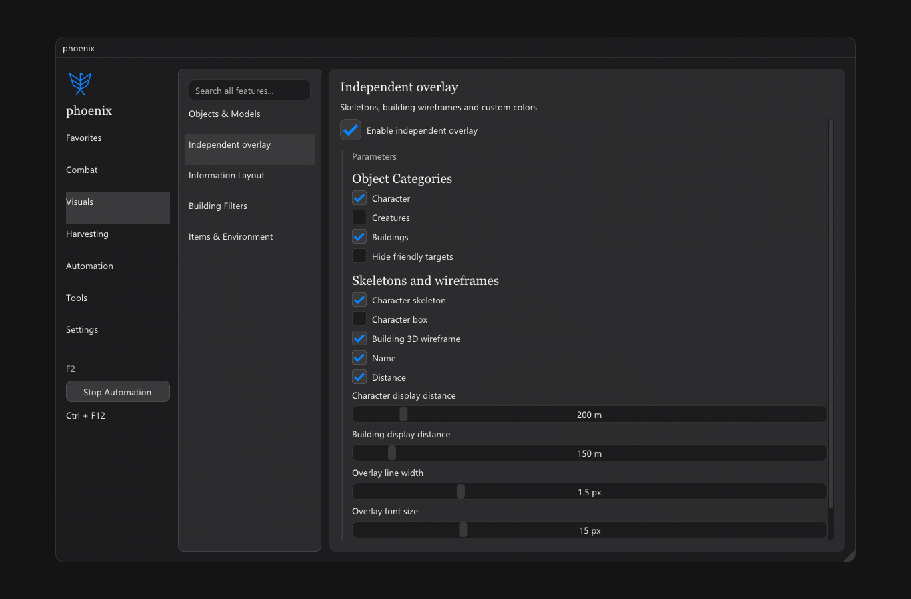

<p align="center"></p>

<p align="center"><a href="README.md">简体中文</a> · <strong>English</strong></p>
<p align="center">
  <a href="https://github.com/2683445453/phoenix-asa/actions/workflows/ci.yml"></a>
  <a href="https://github.com/2683445453/phoenix-asa/releases/latest"></a>
  <a href="LICENSE"></a>
</p>

A Windows x64 **client extension for ARK: Survival Ascended**, with Chinese / English menus, an independent overlay, shortcuts and Lua tools. Evolved from [zetsr/Begeerte-ASA](https://github.com/zetsr/Begeerte-ASA), independently maintained with the upstream copyright and MIT license retained.

## Interface


<table>
  <tr><td width="50%"></td><td width="50%"></td></tr>
  <tr><td align="center">Independent overlay · Appearance and display</td><td align="center">Shortcuts · Common controls in one place</td></tr>
</table>

Images are offline renders of the project's actual ImGui menus, with game data supplied by test doubles.

## Quick start

1. Download `phoenix.zip` from [Releases](https://github.com/2683445453/phoenix-asa/releases/latest) and extract the entire archive.
2. Keep `phoenix.exe`, `phoenix.dll`, `language/`, `lua/` and `work_shop/` together. Run `phoenix.exe` and start the game.
3. Press **F2** to toggle the menu and **Ctrl + F12** to stop built-in automation. Select Chinese / English in the menu.

Fully exit the game before updating files; keep your personal `cfg/` and `logs/`. `phoenix.exe --check` checks that the DLL exists; it does not validate game compatibility.

## Version and validation

| Item | Current baseline |
| :-- | :-- |
| Release | `2026.10.24.2` |
| Game client | ASA **94.34** · CL **833800** · Steam build **26003405** |
| SDK checks | 6 core addresses, 4 hook signatures, 18 native classes / 1,954 fields |
| Automated checks | Windows x64 build, package integrity, translation parity and 26 offline regression groups |

SDK layouts and offsets need revalidation after game updates. Offline Actions tests do not cover live servers or every gameplay feature; feature behavior requires in-game verification.

## Build and test

Requires Windows x64, Visual Studio 2026 C++ Build Tools (**v145**) and a Windows 10/11 SDK. Check scripts also require Python 3. Dependencies are included, including the required LuaJIT x64 `lj_vm.obj`.

```powershell
.\build-release.ps1 -Rebuild
python .\tests\check_client_compatibility.py
.\tests\run-ci-suite.ps1 -Suite Core      # Or Gameplay / Graphics
python .\tests\language_package_integrity.py --require-clean
```

Outputs: `dist/phoenix/`, `dist/phoenix.zip` and its SHA-256 file. Set `-MSBuildPath 'D:\VS\MSBuild\Current\Bin\MSBuild.exe'` to override discovery, or `-CompileJobs 2` to limit compiler concurrency. Packages include both READMEs, licenses, source provenance in `release.json` and per-file hashes; personal settings, logs and debug symbols are excluded.

## Attribution and license

Licensed under [MIT](LICENSE). Original copyright belongs to **zetsr**; modifications belong to their respective contributors. Third-party components retain their own licenses. The package's `licenses/` directory includes notices for HarmonyOS Sans and UnrealContainers.

The licensing of the generated SDK and its UTF-N code still needs confirmation before public redistribution; the upstream MIT license does not replace third-party permission. `server/` and `_Data/` contain separate experiments and reference sources, excluded from the default package.
