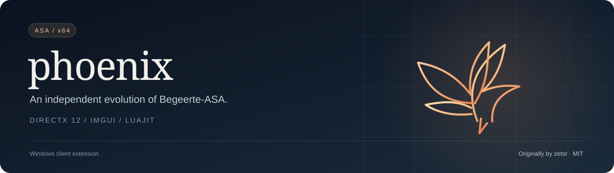
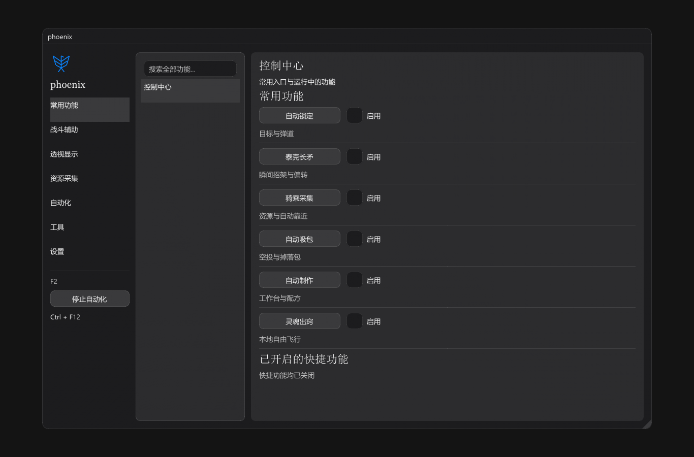
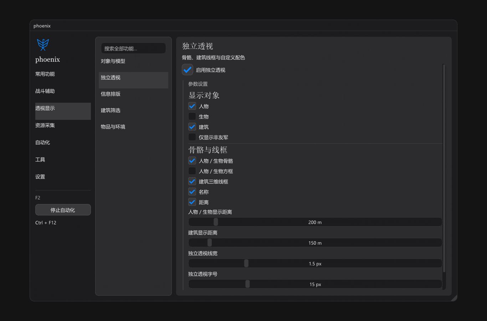
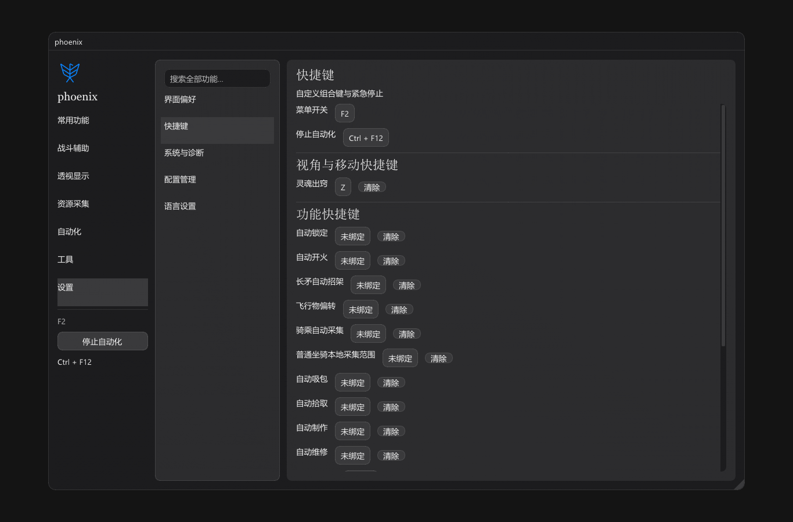

<p align="center"></p>

<p align="center"><strong>简体中文</strong> · <a href="README.en.md">English</a></p>
<p align="center">
  <a href="https://github.com/2683445453/phoenix-asa/actions/workflows/ci.yml"></a>
  <a href="https://github.com/2683445453/phoenix-asa/releases/latest"></a>
  <a href="LICENSE"></a>
</p>

Windows x64 的 **ARK: Survival Ascended 客户端扩展**，提供中英双语界面、独立叠加层、快捷操作与 Lua 工具。由 [zetsr/Begeerte-ASA](https://github.com/zetsr/Begeerte-ASA) 演化而来，独立维护，保留上游版权与 MIT 许可。

## 界面预览



<table>
  <tr><td width="50%"></td><td width="50%"></td></tr>
  <tr><td align="center">独立叠加层 · 外观与显示控制</td><td align="center">快捷操作 · 常用功能集中管理</td></tr>
</table>

插图来自项目真实 ImGui 菜单的离线渲染，游戏数据使用测试替身。

## 快速开始

1. 从 [Releases](https://github.com/2683445453/phoenix-asa/releases/latest) 下载并完整解压 `phoenix.zip`。
2. 保持 `phoenix.exe`、`phoenix.dll`、`language/`、`lua/`、`work_shop/` 的相对位置，运行 `phoenix.exe` 等待游戏启动。
3. **F2** 开关菜单，**Ctrl + F12** 停止内置自动化；在菜单中切换中文 / English。

更新前完整退出游戏，再覆盖程序与资源；保留个人 `cfg/`、`logs/`。`phoenix.exe --check` 可检查 DLL 文件是否存在，不验证游戏兼容性。

使用前请临时禁用 ReShade；其图形代理可能造成菜单不显示或呈现失败。本次实机检查在未加载 ReShade 的环境中完成。

## 版本与验证

| 项目 | 当前基线 |
| :-- | :-- |
| 分发版本 | `2026.10.24.2` |
| 游戏客户端 | ASA **94.34** · CL **833800** · Steam build **26003405** |
| SDK 核验 | 6 个核心地址、4 处 Hook 签名、18 个原生类 / 1954 个字段 |
| 自动化检查 | Windows x64 编译、分发包完整性、中英文本一致性、26 组离线回归 |

游戏更新后需要重新核验 SDK 与偏移。Actions 的离线测试不覆盖真实服务器或全部游戏功能；具体功能效果以游戏内验证为准。

## 构建与测试

需要 Windows x64、Visual Studio 2026 C++ Build Tools（**v145**）和 Windows 10/11 SDK；Python 3 用于检查脚本。依赖随源码提供，包括必需的 LuaJIT x64 `lj_vm.obj`。

```powershell
.\build-release.ps1 -Rebuild
python .\tests\check_client_compatibility.py
.\tests\run-ci-suite.ps1 -Suite Core      # 也可选 Gameplay / Graphics
python .\tests\language_package_integrity.py --require-clean
```

输出为 `dist/phoenix/`、`dist/phoenix.zip` 和 SHA-256 校验文件。可用 `-MSBuildPath 'D:\VS\MSBuild\Current\Bin\MSBuild.exe'` 指定工具，`-CompileJobs 2` 控制编译并发。包内包含双语 README、许可证、`release.json` 源码来源和逐文件校验值，不含个人配置、日志或调试符号。

## 来源与许可

本项目使用 [MIT License](LICENSE)，原始版权归 **zetsr**，修改归相应贡献者。第三方组件遵循各自许可，分发包 `licenses/` 保留相关声明，包括 HarmonyOS Sans 字体与 UnrealContainers。

生成 SDK 及其中 UTF-N 代码的许可仍需在公开再分发前确认；上游 MIT 许可不替代第三方权利授权。`server/`、`_Data/` 为独立实验及源码参考，不进入默认分发包。
